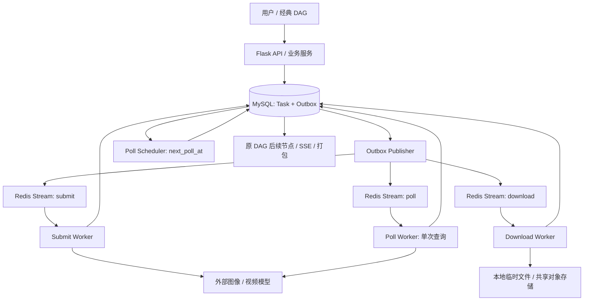

# AI Video Factory 消息队列与可靠异步任务机制引入说明书

> **版本**：v1.0 · 2026-10-16  
> **目标读者**：项目开发者 / Codex  
> **建议技术**：Flask + MySQL + Redis Streams + 独立后台 Worker 进程  
> **性质**：待结合仓库审计落地的设计方案，**不是已实现功能说明**。

## 1. 背景与改造目标

现有 AI Video Factory 已具备图像 / 视频生成、外部模型任务提交和状态查询、结果存储 / 打包、节点级重跑及 19 节点 DAG 等能力。本次改造不替换原有生成能力，而是解决长时间异步任务中 Web 请求耦合、状态查询与下载耦合、进程崩溃恢复困难，以及任务状态更新与消息发送双写不一致等问题。

**本次必须达成的目标：**

1. 将一次图像 / 视频生成生命周期拆为 **Submit（提交）→ Poll（查询）→ Download（下载）** 三个独立执行阶段；能够独立重试、恢复和监控。
2. 以 **Redis Streams** 分发实际执行工作；以 **MySQL** 作为任务、工件和 Outbox 状态的权威来源。
3. 使用 **Transactional Outbox** 保证“同一 MySQL 事务内的业务状态变更 + 待投递事件记录”原子提交；尤其保证“标记生成已完成、待下载 + 写入 `DownloadRequested` 事件”同一事务完成。
4. 引入用户请求幂等、Stream 重复消费幂等、状态机原子转换、租约和故障恢复。
5. 保留现有经典工作流、DAG、模型适配、Prompt 版本与打包功能；暂不引入 LangGraph 或重写业务。

**明确不在本期实现：**完整全局 RPM 限流器、多租户公平调度、复杂队列优先级系统、GPU 推理调度、对现有业务架构进行微服务化、自动视频质量 Review Agent。

> **重要边界**：不引入限流器不等于具备遵守第三方 API 配额的能力。通过限制 Worker 并发只能减少突发压力，不能保证每分钟请求数低于提供商硬上限。本期必须处理 HTTP 429 / `Retry-After`、设置可控重试与暂停开关；若用于真实高流量环境，补充分布式全局限流应作为上线前必备能力。

## 2. 总体架构



**四个主要运行角色：**

| 角色 | 核心职责 | 运行建议 |
|---|---|---|
| Submit Worker | 消费提交消息，调用一次生成接口，保存提供商任务标识 | 与 Web API 分进程；可独立扩容 |
| Poll Scheduler | 从 MySQL 按 `next_poll_at` 领取到期任务，创建可靠 Poll 事件 | 定时短事务；无网络轮询 |
| Poll Worker | 一次只查询一个提供商任务状态并更新下次查询时间 | 短 I/O、无 `while sleep` 占坑 |
| Download Worker | 下载、校验、保存工件，驱动 DAG 后续节点 | 独立并发上限，避免大文件影响 Submit |

**部署约束**：它们可以属于同一个代码仓库和后端业务模块；初期可以共用后台 Worker 容器，但 **Web API 应与长任务执行进程分离**。不要求将三种 Worker 做成三个微服务。

## 3. 队列与消息契约

建议三个 Redis Streams：

- `avf:task:submit` → 消费者组 `submit-workers`。
- `avf:task:poll` → 消费者组 `poll-workers`。
- `avf:task:download` → 消费者组 `download-workers`。

消息尽量轻量，不在 Redis 中放视频、图片或完整 Prompt。示例：

```json
{
  "event_id": "evt-uuid",
  "event_type": "DownloadRequested",
  "task_id": "task-uuid",
  "generation": 2,
  "schema_version": 1
}
```

Worker 使用消息中的 `task_id` 查 MySQL，检查状态与 `generation` 是否仍有效。**消息 ID 不等于业务操作 ID**；即使同一事件被多次 `XADD`，必须不产生重复外部生成或重复工件。

Redis Streams 采用消费者组与 ACK：消息处理的业务状态持久化成功后 `XACK`；进程崩溃时通过 PEL、`XAUTOCLAIM` 等机制恢复未确认消息。默认按照 **at-least-once（至少一次）** 投递设计，不承诺 exactly-once。

## 4. 数据模型与状态机

建议在现有模型上增补所需字段，而非无条件新建平行表。以下为逻辑字段与示例名称，最终应依据仓库实体确定：

**`generation_task`（任务主表）**：

- `id`、`project_id`、`asset_type`（image/video）、`provider`、`model`；
- `client_request_id`、`operation_version`：区分重复请求与用户主动重新生成；
- `status`、`provider_task_id`（可空）、`provider_result_ref`（可空）；
- `next_poll_at`、`poll_generation`、`poll_lease_until`；
- `submit_lease_until`、`download_lease_until`、`retry_count`、`last_error`；
- `artifact_ref`、`created_at`、`updated_at`。

**`outbox_event`（待发布事件表）**：`event_id`、`event_key`（唯一）、`event_type`、`aggregate_id`、`payload`、`status`、`available_at`、`publish_attempts`、`created_at`、`published_at`。建立 `(status, available_at)` 索引，发布失败可重试。

**推荐状态机**：

```text
CREATED → SUBMIT_PENDING → SUBMITTING → SUBMITTED/RUNNING
                 ↘ FAILED        ↘ SUBMIT_UNKNOWN（外部成功与否不明确）
SUBMITTED/RUNNING → DOWNLOAD_PENDING → DOWNLOADING → COMPLETED
        ↘ FAILED                      ↘ FAILED（可恢复后重试）
```

- `COMPLETED` 表示**工件已成功落盘/入对象存储且数据库确认**，不是仅指提供商生成完成。
- 视频和图像可共享这个状态机，但若提供商图片接口同步返回 URL/数据，允许**跳过 Poll 阶段**直接进入 `DOWNLOAD_PENDING`。
- 持久化**任务状态**与**消息投递状态**两类信息，不因已发消息而认为业务已完成。

## 5. Submit 阶段：请求幂等 + Outbox

**API 接收时**：

1. 校验用户、资源权限、参数、项目/工件上下文，生成或接收 `client_request_id`。
2. 在**同一个 MySQL 事务**中插入任务 `SUBMIT_PENDING`，并插入 `SubmitRequested` Outbox 事件。
3. 立即返回 `202 Accepted + task_id`；前端通过既有 SSE / Task 查询获得后续状态。
4. 同一用户、同一次逻辑生成操作的重复请求，依靠数据库唯一约束返回原 Task ID。用户手动“重新生成”必须启用新的操作版本或幂等键。

**Submit Worker 消费时**：

1. 验证状态，使用短事务和条件更新领取 `SUBMIT_PENDING → SUBMITTING`，设置租约；**外部 HTTP 请求不在 MySQL 事务中执行**。
2. 调用现有模型适配层一次；若返回 `provider_task_id`，在 MySQL 保存其值、设置 `SUBMITTED` 和首个 `next_poll_at`；如果同步返回生成结果引用，直接转为 `DOWNLOAD_PENDING` 并写 `DownloadRequested` Outbox。
3. 持久化成功再 `XACK`。遇可重试的错误按退避策略重新安排，不进行无界紧密重试。
4. **外部提交已成功但 Worker 在保存返回值之前崩溃**：若提供商支持客户端幂等键或以客户端请求 ID 查询，先利用这些能力确认；否则进入 `SUBMIT_UNKNOWN` 待对账，**不得盲目再次付费提交**。

**事务示意（不可直接当生产 SQL 使用）**：

```sql
BEGIN;
INSERT INTO generation_task(id, status, client_request_id, ...)
VALUES (:task_id, 'SUBMIT_PENDING', :request_id, ...);
INSERT INTO outbox_event(event_id, event_key, event_type, aggregate_id, ...)
VALUES (:evt_id, :event_key, 'SubmitRequested', :task_id, ...);
COMMIT;
```

## 6. Poll 阶段：基于时间的调度，不是长期占用线程

**设计选择：`MySQL next_poll_at + Poll Scheduler + Redis Streams`。** 不采用“Submit 完成后直接把 Poll 消息丢入 Stream，Worker 等三分钟”的方式，因为 Redis Streams 本身不提供按指定时间延迟消费功能。

调度器每隔适当时间执行一次**索引化批量到期查询**：

```sql
SELECT id, provider_task_id
FROM generation_task
WHERE status IN ('SUBMITTED', 'RUNNING')
  AND next_poll_at <= NOW()
  AND (poll_lease_until IS NULL OR poll_lease_until < NOW())
ORDER BY next_poll_at
LIMIT :batch_size;
```

建议为 `(status, next_poll_at)` 建联合索引。上面只展示筛选条件，实际派发时必须用**短事务 + 原子领取 / `FOR UPDATE SKIP LOCKED` / 租约**防止多个 Scheduler 抢同一任务：

1. 原子领取到期任务，更新 `poll_generation` 和 `poll_lease_until`。
2. 同一事务插入唯一 `PollRequested(task_id, poll_generation)` Outbox 记录。
3. Outbox Publisher 投递 Poll Stream；Poll Worker 验证 generation 与当前状态，过期事件直接 ACK。
4. Poll Worker 只向上游查询**一次**；若仍在生成，原子写入新 `next_poll_at`、清除租约；若成功，转入下载阶段。
5. 如果调度/查询进程崩溃，租约过期后可重新派发；请求超时应短于合理租约，避免正常运行中的 Poll 被误判过期。额外通过业务代数/版本防止陈旧响应覆盖较新状态。

**轮询频率策略**：依据模型历史生成时间，设置适当的首次等待；后续采用分级间隔、退避与少量随机抖动，避免任务集中轮询。Poll Scheduler 扫 MySQL ≠ 对上游视频平台发起 Poll；500 个等待任务并不意味着 500 个常驻线程。

## 7. Download 阶段：必须保证的事务原子性

**用户明确要求的核心事务：** Poll Worker 观察到模型平台生成完成后，**同一 MySQL 事务**完成：

1. 原子校验任务目前处于 `SUBMITTED/RUNNING`，转为 `DOWNLOAD_PENDING`，记录模型结果引用与必要元数据；
2. 插入唯一 `DownloadRequested(task_id, operation_version)` Outbox 事件；
3. 事务 COMMIT 后，再由 Outbox Publisher 发送到 Download Stream。

```sql
BEGIN;
UPDATE generation_task
SET status = 'DOWNLOAD_PENDING',
    provider_result_ref = :result_ref,
    updated_at = NOW()
WHERE id = :task_id
  AND status IN ('SUBMITTED', 'RUNNING');
-- 仅当上面的状态转换真正成功时，插入事件；
-- event_key 必须唯一，例如 download:<task_id>:<operation_version>。
INSERT INTO outbox_event(event_id, event_key, event_type, aggregate_id, ...)
VALUES (:evt_id, :event_key, 'DownloadRequested', :task_id, ...);
COMMIT;
```

这确保 MySQL 中**生成完成、待下载状态**和**待投递下载事件**不会出现只提交一半的情况。它**不代表 MySQL 与 Redis 跨系统原子提交**，也**不能阻止 Outbox Publisher 重复发送消息**；必须由消费者做业务幂等。

**Download Worker 消费时**：使用状态 CAS 与下载租约领取；采用稳定工件键（例如 `project_id/task_id/operation_version`），下载到临时位置、校验内容与大小/格式，再原子转为正式工件；最后提交工件记录和 `COMPLETED` 状态，然后 ACK。若文件已存但 DB 未提交，重试时应核对工件并补齐状态，而不是生成重复副本。多进程/多主机部署时优先使用共享对象存储，避免绑定某台机器的本地磁盘。

> **安全提示**：模型返回的下载地址只能按可信提供商域名和授权规则访问；校验跳转、文件类型和文件大小，防止 SSRF 与恶意下载。不要让任意用户输入直接成为服务器侧下载 URL。

## 8. Outbox Publisher 与恢复机制

**Publisher 执行方式**：批量扫描待发布 Outbox → `XADD` 到对应 Stream → 在 MySQL 标记 `PUBLISHED`。需支持失败重试、合理批大小和多个 Publisher 的原子领取；同一个事件可能被 XADD 多次，允许重复不允许丢失。

**典型失败与恢复**：

| 失败位置 | 可能后果 | 恢复策略 |
|---|---|---|
| MySQL 已提交、Redis 不可用 | 消息尚未发出 | Outbox 保留，恢复后重发 |
| `XADD` 成功、Publisher 更新 MySQL 前崩溃 | 消息重复 | 相同 `event_id/event_key` 幂等消费 |
| Worker 领取消息后崩溃 | PEL 存在未 ACK 消息 | `XAUTOCLAIM` + DB 状态/租约校验 |
| 已调用模型但未保存 provider ID | 外部执行状态不确定 | 上游幂等键 / 查询对账 / `SUBMIT_UNKNOWN` |
| Poll 查到完成，数据库提交前崩溃 | 下载事件尚未生成 | Poll 租约过期后重新查询并原子转移 |
| 文件保存成功、DB 标记完成前崩溃 | 文件已存在但任务未完成 | 稳定工件键 + 校验后恢复提交 |

另设轻量 **Task Reconciler**：周期检查超时租约、过期 `SUBMITTING`、未完成任务、陈旧 Outbox 及已存在但数据库未确认的工件。对于上游结果不确定的付费提交，**自动对账优先，绝不无条件重复请求**。

## 9. 并发、异常与可观测性（本期控制范围）

- 三类 Handler 逻辑隔离、设置明确的 Worker 并发上限；下载独立 I/O 并发；数据库外部 API 调用不持锁。
- 接口超时、网络重试与 `429 Retry-After` 均需有界；避免无限重试或死循环，重试时间持久化。
- Poll 不应高频全量查询上游。调度批次、首次轮询时间、最大重试间隔可配置。
- 不假定“无限队列就能解决超额流量”；对队列积压提供基础监控、暂停接收或人工管理开关。
- Redis Streams 的持久化、消费者组、PEL 回收与裁剪策略需通过压测及故障演练确认；不能过早删除仍在处理中消息。
- 建议指标：API 202 接收率、待提交任务数、各 Stream 积压、Outbox 最老待发送事件、Poll 到期延迟、Provider 429/超时比例、任务总耗时 P95、成功交付率、重复外部提交次数、下载失败率。

## 10. 分阶段改造路线

| 阶段 | 开发内容 | 验收门槛 |
|---|---|---|
| **Phase 0：只读审计** | 盘点现有同步/异步图片视频模型、Task 状态、DAG 回调、SSE、打包和重复执行风险 | 输出接口图、状态映射、测试基线，不改核心逻辑 |
| **Phase 1：Submit + Outbox** | 建立任务幂等键、Outbox、Publisher、Submit Stream、Worker | 重复点击只产生一次逻辑任务；写 DB 后 Redis 故障不丢消息 |
| **Phase 2：Poll Scheduler** | `next_poll_at`、租约、Poll Stream、短时状态查询、同步图片跳过 Poll | 无常驻等待任务线程；并行 Scheduler 不重复派发有效 Poll |
| **Phase 3：Download + 原子事件** | 完成态 + `DownloadRequested` 同事务、下载 Worker、稳定工件键、DAG 衔接 | 崩溃恢复后最终工件不重份，经典工作流能继续运行与打包 |
| **Phase 4：恢复与验证** | Reconciler、PEL 恢复、重试与退避、监控、故障注入及回归测试 | 故障场景符合预期、无静默任务丢失，文档与迁移脚本齐备 |

每阶段提交测试与迁移方案，通过验收后才进入下一阶段；采用 feature flag 逐步切换新旧执行路径，保留回滚能力。优先复用现有业务服务，**不得因个别失败场景不断增加特化分支或复制旧逻辑**。

## 11. 必须编写的测试用例

1. **API 幂等**：同一用户重复相同 `client_request_id`，只创建一条逻辑任务及唯一 Submit 事件；主动重新生成产生新操作版本。
2. **Outbox 恢复**：MySQL 事务提交后关闭 Redis，恢复连接后仍可投递事件。
3. **重复消费**：相同 Submit/Poll/Download 消息重复交付，业务状态及工件不会重复推进。
4. **提交不确定性**：模拟上游接收成功但响应丢失，系统不自动重复付费请求，能进入待对账状态。
5. **并发领取**：多 Worker、多个 Scheduler 并行执行时，同一状态版本只能被合法领取一次。
6. **Poll 延迟**：刚提交的任务不会立即循环查询，未完成任务写入新的 `next_poll_at`；无需每任务长期占用线程。
7. **Download 事务原子性**：模拟事务提交前崩溃，状态与 Outbox 事件同时回滚；提交后 Publisher 故障可恢复。
8. **下载恢复**：对象已保存但 DB 更新前崩溃，重试仅补齐确认；不产生重复工件。
9. **经典模式回归**：19 节点 DAG、节点重跑、SSE、Prompt 追踪、一键打包行为与原版保持一致。
10. **负载模拟**：使用 Fake Provider 而非付费 API 注入数百突发请求，验证可接受请求、队列与任务恢复；**不将此测试等同于已满足上游 RPM 配额**。

## 12. 交付物与 Codex 执行要求

**交付物**：源码审计结论、状态机及字段映射、数据库迁移、三类 Stream / Handler、Poll Scheduler、Outbox Publisher、Task Reconciler、监控日志、自动化测试与部署文档。

**给 Codex 的执行约束**：

> 角色：资深 Python 后端 / 分布式任务系统工程师。  
> 背景：AI Video Factory 已有经典视频生成 DAG 及模型接口，需要以最小改动引入 Redis Streams 和可靠异步任务机制。  
> 任务：首先执行 Phase 0 只读审计，核实现有任务实体、异步/同步供应商接口与工件保存路径；输出细化实施方案并标出与本设计不同之处。得到确认后逐阶段实现。  
> 约束：不重写原 DAG、不新增 LangGraph、不引入完整 RPM 限流器、不复制现有业务逻辑、不制造面向某单一错误的特化代码；所有重要状态转换需原子化、可重试且可观测。  
> 验收：各阶段按第 10、11 节要求提供可复现测试，验证兼容性、幂等性、Outbox 一致性和崩溃恢复。

---

**最终架构决策**：**Submit 和 Download 是事件驱动，Poll 是时间驱动。MySQL 负责真实状态，Outbox 负责可靠事件投递，Redis Streams 负责异步分发，Worker 负责短时执行。** 先保证正确性、可恢复和可回滚，再根据真实流量评估是否增加全局限流和进一步独立扩容。
