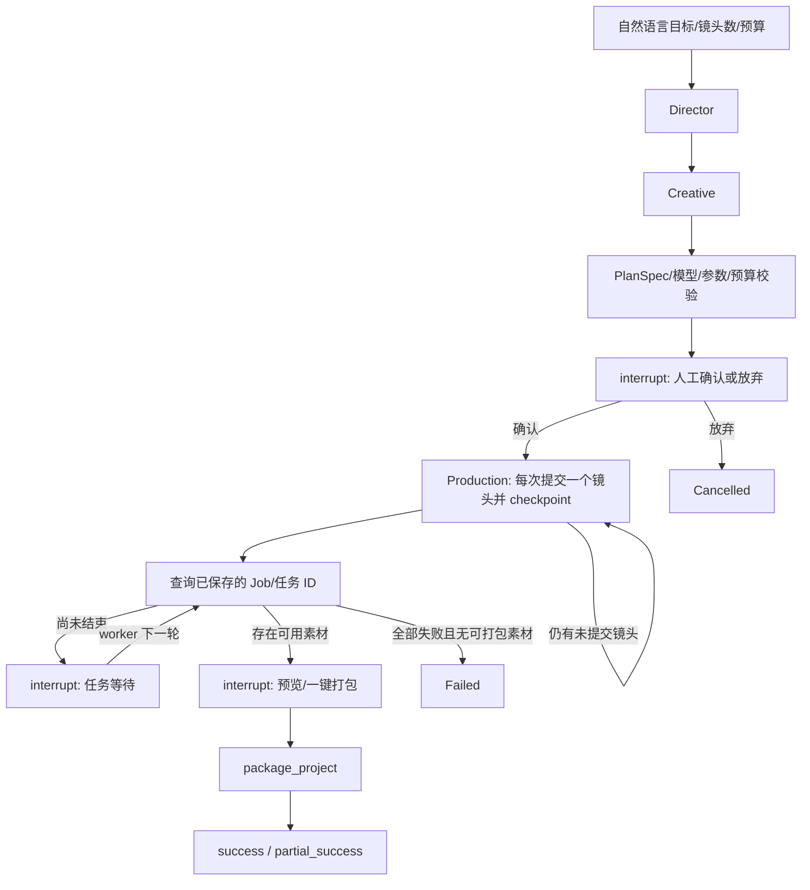

# Phase 2：LangGraph 从零创作 MVP

本阶段在 Phase 1 的 Tool Registry 上新增 Director、Creative、Production 状态图、持久化后台 worker 和 Agent Studio。经典 19 节点 DAG 继续负责生成、轮询与工件管理。默认 `AGENT_MODE_ENABLED=false`，关闭时不注册 Agent/Skills API，也不显示侧栏入口。

## 启动

后端安装 `backend/requirements.txt`（Python 3.12 验证通过），执行迁移与 seed：

```bash
cd backend
python -m pip install -r requirements.txt
flask --app run.py db upgrade
flask --app run.py seed-defaults
```

在项目根目录 `.env` 配置 `AGENT_MODE_ENABLED=true`。API 服务沿用原启动方式；另一个终端在相同环境和目录运行：

```bash
flask --app run.py agent-worker
```

Worker 必须持续运行；`--once` 只用于单次诊断，不能替代长期 worker。启用 MQ 后，还需运行共用 MQ worker；最新本地启动步骤见[主 README](../../README_zh.md)。默认使用现有的 `DEFAULT_PROMPT_REWRITE_MODEL` 作为规划模型，也可设置 `AGENT_PLANNER_MODEL`，要求启用的 `prompt_rewrite`/`text_to_text` 模型使用 `qwen_chat` 适配器。真实模式需配置相应供应商凭据；规划通过现有 Chat 适配器的 JSON object 模式返回结构化数据，由 Pydantic 强校验。不会隐式补发格式修复请求。

Docker：在 `.env.production` 开启 Agent 模式，然后执行 `docker compose --profile agent up -d --build`。新增 worker 服务与 backend 共用 MySQL 和 `backend_storage`。worker 不运行 HTTP 服务，禁用继承的 HTTP 健康检查。

## 无付费演示

```bash
cd frontend-vue
npm ci
npm run build
cd ..
python backend/scripts/agent_demo.py
```

打开 `http://127.0.0.1:5092/agent-studio`，使用演示账户 `demo / agent-demo-only`。演示强制 Mock，独立数据库与存储位于 `backend/storage/agent-demo`，不读取或修改正常业务数据库。输入目标 → 生成计划 → 编辑首帧/动作提示词 → 确认 → 查看每个镜头与 Job 日志 → 一键打包。Mock 视频是现有适配器写出的文本占位文件，不能当作可播放成片；界面明确标注演示模式。

## 状态图与职责



- Director：自然语言 → `Brief(title, objective, visual_style, story_arc)`。
- Creative：Brief + 指定镜头数 → Phase 1 `PlanSpec`。首帧静态描述与视频动作提示词分离；参数只允许注册模型的 Schema。
- Production：确定性地调用 `produce_shot`、`get_task_status`、`package_project`；不允许模型生成任意工具名、角色、审批、幂等键或预算范围。
- 新增规划工具仅注册在 Agent 图的 Registry 实例中，不扩张 Phase 1 通用工具 API 的工具目录。
- 一镜头一 Job；提交过程不等待镜头完成，图像成功后由该 Job 的 DAG 立即消费首帧生成视频。Job 并发沿用原有队列配置。

## 协议与校验

`CreateRun`：`goal`（1–8000 字符）、`shot_count`（1–20）、`budget_limit`（有限正数，默认 100、服务器上限默认 500）、`request_key`（1–128 字符），以及可选的 `video_model_preference`（1–120 字符，视频模型 ID、别名或系列）。输入多余字段拒绝。

`PlanSpec` 继续使用 Phase 1 格式。Phase 2 只接受 `from_scratch`，镜头数必须与请求一致，shot_id 唯一，提示词非空。模型必须已启用且匹配能力；参数遵循现有 model_guard；每个镜头仅生成一张首帧。计划提交确认前钉定模型 ID 与公开默认参数，确认时再次校验。用户可在确认请求中提交修改后的 PlanSpec，生成开始后不可改写已执行计划。

预算为抽象 credits：Director 1 + Creative 1 + 每镜头 12。创建请求即校验足额，生产逐次经过 ToolRegistry 再校验。这不是供应商实际金额；不同分辨率/时长的真实计价仍属于 Phase 4。单 worker 串行提交工具，避免本会话并发预算检查竞争。

## 视频模型选择与系列约束

`agent/model_policy.py` 统一管理模型规则。没有显式要求时，按每种视频能力对应的节点 `config.model_id` → `DEFAULT_T2V_MODEL` / `DEFAULT_I2V_MODEL` / `DEFAULT_R2V_FLASH_MODEL` 获取服务器默认值，保存会话时固定下来。Agent 不可自行改为其他模型。

用户可在原始 `goal` 中写“要求使用 wan2.7 系列的视频生成模型”“使用 happy-horse-i2v”，也可填写界面中的可选视频模型字段。后端根据注册表中的模型 ID、展示名、系列及已知别名识别要求，形成不可由 LLM 改写的 `request.video_model_policy`。规则识别常见中英文“使用／指定／use／using”等表达；用户自定义名称或复杂表述可通过 `video_model_preference` 明确指定。原始描述与专门字段的约束取交集，冲突时拒绝，不默默覆盖。

系列约束只限定**视频模型**，不强制首帧图像使用同系列。例如 wan2.7 可匹配 `wan2.7-i2v`、`wan2.7-t2v` 以及服务器后续注册的同系列视频变体，不会匹配 `wan2.70-*`、wan2.6 或 HappyHorse。模型必须已注册、启用且 task_type 匹配；指定具体型号时不允许替换成同系列的另一个型号。未找到或冲突的要求在创建时返回 `422 MODEL_PREFERENCE_UNAVAILABLE`，尚未产生规划和生成费用。

Creative 仅接收符合策略的候选模型与参数 Schema；优先采用符合要求的服务器默认模型，否则由 Creative 在候选内选择。模型 ID 留空时，后端选择符合要求的默认模型，或按 model_id 排序选取首个合格候选，保证结果可复现。该顺序不是质量、价格排名。

计划校验、人工确认、生成工具提交、工具重放／重试及 Job 恢复均检查同一策略。审批请求不能用修改 PlanSpec 的方式移除用户原来的系列限制。模型在确认后被禁用时停止，不跨系列回退。策略同时写入 Job config，便于日志追踪和重跑校验。界面展示“服务器默认／用户指定”与原始要求。

约束复用于 `produce_shot` 和 `generate_video(mode=t2v/i2v/r2v)`，因此换生成方式也不能越过限制。如果当前系列没有某种能力，返回 `MODEL_CAPABILITY_UNAVAILABLE`；例如现有注册表中的 wan2.7 无 R2V，不能退回 `wan2.6-r2v-flash`。

当前 Phase 2 从零创作状态图仍采用首帧 → I2V；本次增加跨能力的模型约束，没有增加状态图自动选择 T2V／R2V 的路由。仅支持 T2V 的型号无法用于该 MVP 的 I2V 镜头，会在规划前提示能力不匹配。

## 数据与恢复

| 数据 | 存储/映射 |
|---|---|
| 会话索引、所属用户、创建幂等键、命令 inbox、状态摘要、原始视频模型策略 | 业务数据库 `agent_runs`（迁移 `20261016_001`）；策略复用现有 request JSON，无额外迁移 |
| 图节点状态、interrupt、已确认计划、镜头 Job/Invocation ID | `SqliteSaver`，`thread_id = agent_runs.run_id` |
| Checkpoint 文件 | 默认 `STORAGE_ROOT/agent/checkpoints.sqlite`，可通过 `AGENT_CHECKPOINT_PATH` 指定 |
| 预算、工具输入输出、错误 | 原 `tool_invocations`；`budget_scope = run_id` |
| 镜头、厂商任务、工件、日志 | 原 `jobs/api_tasks/artifacts/job_events/job_node_runs` |
| 来源 | Job config 中原有 `skill` 标签、`shot.shot_id`；隔离模板 `agent_workspace` |

HTTP 仅写 durable inbox；worker 在图 checkpoint 成功后清空命令。审批和打包只接受匹配的 interrupt，避免重启后残留审批命令误触发交付。命令入队使用条件更新防止双击；创建唯一键按用户隔离，相同 key 不同输入返回 409。

worker 持有独立 SQLite 文件事务锁，进程退出即释放，第二个 worker 会拒绝启动。MVP 限制为**同一持久化本地目录上的单 worker**，API 可以多进程；不支持跨主机/NFS checkpoint 或多个独立 checkpoint 目录同时调度同一业务库。业务 DB 和 checkpoint 目录需一起保留。分布式租约/生产级共享 checkpointer 是 Phase 4 边界。

恢复规则：

1. Agent 重启从 checkpoint 继续，不从 Director 重跑。
2. 工具成功、图 checkpoint 尚未提交：使用固定幂等键重放账本输出，不追加费用。
3. Job 建立后、工具输出尚未提交：通过账本 Job 关联或 `config.skill.invocation_id` 找回原 Job，不再建新 Job。
4. 孤立 pending/queued/running Job：跳过成功提交节点，恢复已有厂商任务的 poll；若提交节点仍 running 但已有 `provider_task_id`，修复节点成功记录后续跑。
5. 提交结果不明且没有厂商任务 ID：标记该 Job 失败并记录 `AGENT_RECOVERY_BLOCKED`，禁止自动重提，其余镜头继续。
6. 图执行异常进入 `needs_attention`，最多两次显式恢复；恢复不等于重试付费工具。失败/未知规划调用不会自动再次付费。
7. 超时按镜头结束等待并保留 Job 链接，不取消厂商任务，不阻塞其他成功镜头的打包。
8. 免费打包在输出未写入账本时可随显式恢复重做，仍通过 Registry，刷新原 ZIP；已完成的打包输出直接重放。

独立 worker 禁用经典 failure agent，并将传输层 POST 自动重试关闭；经典 API 进程保持旧策略。不能承诺外部厂商“exactly once”：网络中断且未返回任务 ID 时采用停止重提策略。

## 状态与工件

会话状态：`queued → planning → awaiting_approval → producing → awaiting_delivery → delivering → success/partial_success`。拒绝为 `cancelled`；全部失败且无可用素材为 `failed`；图异常为 `needs_attention`。

每个镜头保存 status、terminal、job_id、invocation_id、节点状态、首帧/视频工件 URL、error、validation。完整视频镜头计成功；失败/部分成功镜头单独计失败，不丢弃已生成的首帧或视频。存在可用且已终结 Job 的素材时进入 `awaiting_delivery`。部分失败后打包终态为 `partial_success`，每个可交付镜头仍有下载链接。没有视频但有首帧也允许素材打包，并保留失败原因。

技术校验当前覆盖文件存在、非空、预期视频工件类型；**尚未实现真实解码、精确时长和比例验证**。界面提供图片/视频预览供用户确认，不基于主观质量自动付费重生成。打包复用原服务，输出每 Job 一个 ZIP；不合并 ZIP、不自动拼接视频。

## API 契约

沿用 JWT；每个会话按 JWT identity 隔离。关闭鉴权的本地模式统一使用 `local`。

| 方法 | 路径 | 说明 |
|---|---|---|
| POST | `/api/agent/runs` | 创建（202），body 为 CreateRun；重复同请求返回原会话 |
| GET | `/api/agent/runs` | 当前用户最近 100 个会话 |
| GET | `/api/agent/runs/{run_id}` | 状态、计划、镜头、成功/失败/等待数量、成本、下载链接 |
| POST | `/api/agent/runs/{run_id}/actions` | 202 入队 `{action, plan?}` |

action 为 `approve`、`reject`、`deliver`、`resume`。plan 只允许在 approve 时提供。状态不符/操作待执行返回 409；输入校验 422；预算不足 402；他人会话 404。API 不接受调用方指定角色、approved、budget_scope 或幂等工具键。

```json
{"goal":"一只橘猫走进雨后的书店，暖色电影感","shot_count":3,"budget_limit":50,"request_key":"bookshop-001"}
```

## 验收与测试

```bash
python -m pytest backend/tests -q
cd frontend-vue
npm run build
```

测试强制 Mock、独立临时 DB/存储、拦截外网。`test_agent_mvp.py` 覆盖完整流程、审批前不生成、修改计划、重复操作、非法输入/参数/预算、部分失败、全部失败、拒绝、开关、鉴权/用户隔离、并发 worker 锁、断点恢复、未知提交停止、账本重放与传输重试策略。每个 tick 关闭并重建图及 SqliteSaver，验证不依赖内存 checkpoint。原有经典模式、Skills、迁移测试继续运行。

`test_agent_model_policy.py` 覆盖默认模型、自然语言指定系列、型号别名、否定表达、未知／禁用／冲突型号、版本边界、LLM 越界、审批篡改、三种视频工具能力与恢复校验。

`ShotSpec` 在解析 Creative 输出、审批编辑和 `produce_shot` 输入时，将误放在 `image_params.model_id`／`video_params.model_id` 的选择归位到 `image_model_id`／`video_model_id`。相同模型（包括已注册别名）可去重，冲突选择或非法型号值直接拒绝；空值保留服务器选择。归位后继续执行模型能力、启用状态、视频系列／服务器默认策略与全部参数校验，不静默丢弃模型要求或其他未知参数。Creative 提示词和 JSON Schema 同时明确字段边界。

`test_agent_plan_normalization.py` 的 34 项回归覆盖历史付费失败输出、结构化响应解析、归位幂等与输入不变性、空值／别名／冲突／非法值、默认及系列策略防绕过、其他参数严格校验，以及审批 → Job → 实际适配器载荷 → 打包的模拟完整流程。

真实供应商生成与 MySQL/Docker 的运行验收需要部署环境与凭据；本阶段自动验收不发送付费模型请求。

本次验收记录（2026-10-16）：完整后端回归 **95 passed**（含 16 项 Agent MVP 测试）；Vue 生产构建通过；浏览器完成三镜头自然语言目标 → 分镜修改 → 人工确认 → 生成 → 打包，刷新后仍显示成功数量、原提示词和三个 ZIP 链接，浏览器无错误日志。实际安装验证版本为 LangGraph 1.0.10 / langgraph-checkpoint-sqlite 3.1.2 / Python 3.12。

同日视频模型策略增量验收：完整后端回归 **129 passed**，其中模型策略测试 34 项；Vue 生产构建、Python 编译和 `git diff --check` 均通过。测试包含用户指定 wan2.7 而服务器默认 HappyHorse 的完整生成流程、三种能力的工具约束、审批／恢复／幂等重放限制，以及停用模型后保留已成功素材。全部使用隔离 Mock 数据，未调用付费模型。

同日模型字段归位修复验收：完整后端回归 **163 passed**，含新增的 34 项归位回归；Python 编译与 `git diff --check` 通过。历史失败中 `image_params.model_id=wan2.7-image`、`video_params.model_id=wan2.7-i2v` 的输出现可正常归位并通过完整校验。

本次仅执行一次不指定模型的真实付费重测（`agent-paid-retest-20261016-223721-683cdc`，独立 SQLite／存储、复用服务器模型配置）。规划通过并选择服务器默认 `wan2.7-i2v`，首帧为 `wan2.7-image`，计划参数不含 `model_id`。两次规划请求完成，唯一一次首帧请求发生供应商 HTTP 读取超时（180 秒），因此本次完整生成验收**失败**，视频提交为 0；没有自动重提，HappyHorse 调用为 0。不能据此宣称真实视频生成及打包通过；脱敏记录保存在该次存储目录的 `report.json`／`audit.json`。
