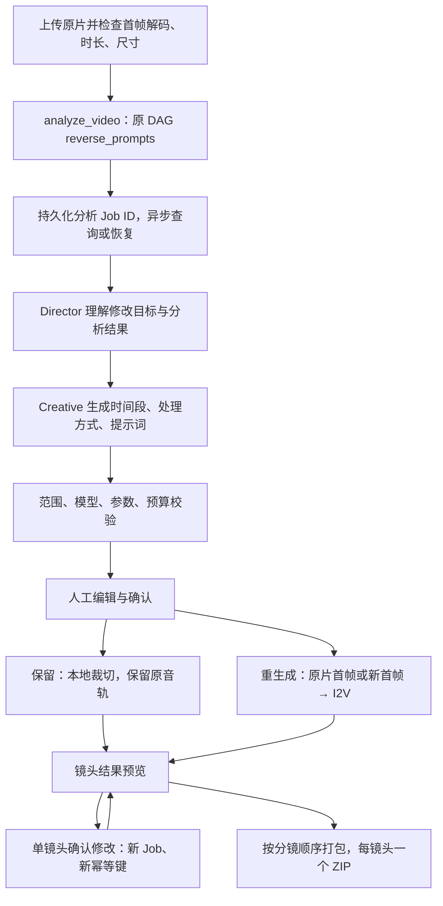

# Phase 3：原视频二次创作

## 范围与复用边界

Agent Studio 现支持上传原视频、描述修改需求、分析原素材、审批镜头计划、保留或重生成镜头、预览后局部修改、打包交付。源素材解码和裁切使用本地 FFmpeg；生成继续通过 Tool Registry → 现有 Job → 原 DAG。经典工作流没有新增节点或改动调度顺序。

不新增数据库表和生产配置项。使用原有 `AgentRun.request/snapshot/command`、`ToolInvocation`、`Job.config`、`Artifact`、`PromptVersion` 和 `JobPromptRef` 保存业务记录。仍由单个持久化 Agent worker 执行，沿用 `AGENT_MODE_ENABLED` 开关。

## 业务流程



从零创作仍走原流程。二次创作的 `analyzing` 状态只增加异步视频理解阶段；HTTP 请求不运行付费模型。上传接口同步进行有界的本地媒体检查。

## 镜头计划

`PlanSpec.mode=remix` 的镜头使用 `RemixShotSpec`，不能混入从零创作镜头。字段包括：

| 字段 | 含义 |
|---|---|
| `shot_id` | 计划内唯一镜头 ID，局部修改保持不变 |
| `source_start` / `source_end` | 原片时间范围，有限数字，满足 `0 <= start < end <= duration` |
| `action` | `keep` 保留，或 `regenerate` 重生成 |
| `first_frame_mode` | `source` 提取原片范围起点首帧，或 `generate` 根据新提示词生成首帧 |
| `edit_reason` | 保留或修改的理由，审批前及局部修改时可编辑 |
| `first_frame_prompt` / `i2v_prompt` | 新首帧／视频动作提示词；实际生成的阶段必须提供相应提示词 |
| 模型与参数字段 | 继续使用 Phase 2 的分离、归位、参数校验与视频模型策略 |

`keep` 只做本地转码裁切，不提交生成模型；`source` 首帧重生成只提交 I2V；`generate` 首帧重生成复用首帧生成 → I2V 的四个 DAG 节点。模型策略仅约束实际发生的视频生成，不约束原片裁切。未指定视频模型时仍固定服务器默认模型，指定系列时不得跨系列替代。

规划使用现有视频理解工具返回的整体叙事描述，时间段是待确认的建议，不是精确场景检测结果。UI 明确提示用户结合原片预览确认范围。重生成片段的时长由视频模型参数决定，源范围用于参考，并不强制输出与原片等长。

## 原片与 Prompt 血缘

- `POST /api/agent/sources` 将文件存入受管理存储，并建立标记上传者的素材 Job。支持 MP4/MOV/MKV/WebM；格式、首帧解码、时长和尺寸不合格时拒绝并清理该次上传。复用已有上传大小上限及 `FFMPEG_BINARY`。
- Agent 创建、审批和生产均绑定原始源工件。API 校验上传者归属，工具再次校验所属会话、分析 Prompt 和上一镜头 Job；LLM 不能提供任意本地路径或另一个会话的来源。
- 视频理解保留原 Job、`t2v` Prompt ID 和内容。每个镜头 Job 的 `config.remix` 记录原工件 ID、时间范围、编辑策略、分析 Prompt ID、上一镜头 Job ID、各新 Prompt 对应的父 Prompt ID。
- 新 Prompt 继续创建 `PromptVersion` 与 `JobPromptRef`；`parent_version` 和 `note` 保留父版本信息。跨 Job 的唯一父 Prompt ID 以 `config.remix.prompt_lineage` 为准，不能只靠同名的 `v1.0` 判断血缘。
- 打包包含 `source_analysis`、`edit_instruction`、实际生成所用的提示词、结果素材，以及 `package_manifest.json.lineage`。保留片段使用 `retained_video` 工件类型，不伪装成模型生成的视频。
- 交付前的局部修改创建新 Job；其余镜头不重跑。`snapshot.shot_history` 保存原计划和结果引用，UI 提供历史 Job 与素材下载。交付包以当前计划的当前版本为准；历史版本仍可在对应 Job 中单独打包。

媒体预览与下载继续沿用经典工件接口的访问策略；本阶段的所属用户校验覆盖 Agent 会话、源素材绑定与工具引用，不改变经典全局工件接口的权限模型。

## API 契约

| 方法 | 路径 | 输入／行为 |
|---|---|---|
| POST | `/api/agent/sources` | multipart `file`，返回工件 ID、文件名、时长、尺寸、预览地址（201） |
| POST | `/api/agent/runs` | 原协议新增 `mode=remix` 和 `source_artifact_id`；从零模式禁止附加原片 |
| POST | `/api/agent/runs/{id}/actions` | `approve` 可提交编辑后的整个计划；`revise` 只提交一个已有镜头 |

创建示例：

```json
{"mode":"remix","source_artifact_id":"art_...","goal":"保留开场，修改后半段的动作","shot_count":3,"budget_limit":100,"request_key":"remix-001"}
```

局部修改必须在 `awaiting_delivery` 阶段，提交 `{action:"revise", shot:完整的RemixShotSpec, request_key:"本次修改的唯一键"}`。相同键和相同输入重放原结果；相同键不同输入返回 409。修改请求明确授权该镜头所需的新增预算；预算不足返回 402，未知镜头、越界范围、违规模型或参数返回 422。

默认从零请求仍省略持久化的 `mode` 字段，保持 Phase 2 已存在的创建幂等键兼容。

## 成本、恢复与故障隔离

资源估算：视频理解 1、Director/Creative 共 2、保留镜头 0、原片首帧重生成 10、新首帧重生成 12。估算不是供应商账单。创建二次创作至少需要 3，计划确认按实际策略验证总额，局部修改按已用预算加本次镜头成本验证，Registry 在实际提交时再次执行预算校验。

分析和镜头生产通过相同工具账本保存幂等键与 Job 关联。图 checkpoint 丢失时恢复原 Job，不重新提交已知任务。恢复检查覆盖所有计费节点；同步视频理解若在提交后中断且结果未知，进入需处理状态，不自动再次付费。

审批命令具有唯一 `command_id`，图中保存 `last_command_id`。局部修改可能再次进入交付 interrupt，因此必须识别已消费命令，避免“checkpoint 已完成、收件箱尚未清空”的退出窗口重复生成。修改历史还保存请求回执，处理 HTTP 响应丢失后的重复提交。

一个镜头失败只影响该镜头。原片不作为生成成功的替代结果；保留片段、成功视频和可用首帧按实际结果展示。存在可用结果时可部分打包。源文件不存在、分析失败或范围不合法均不得继续提交生成。

## 验证与运行

本地需要 FFmpeg 在 PATH 上，或设置已有的 `FFMPEG_BINARY`。Docker 后端镜像已安装 FFmpeg，无需新服务。回归中的模型调用强制 Mock 并封锁外网；媒体检查、裁切、音轨保留和首帧提取使用真实 FFmpeg。

```bash
python -m pytest backend/tests -q
cd frontend-vue
npm run build
```

可运行隔离演示：`python backend/scripts/agent_demo.py --port 5093 --storage backend/storage/phase3-demo`，登录 `demo / agent-demo-only`。只使用指定目录的 SQLite 和素材，不连接生产业务库。

`test_agent_remix.py` 覆盖上传检查与清理、用户归属、时间范围与字段合法性、模型约束、保留／两种重生成、只保留时零生成成本、预算不足、分析与生成断点恢复、未知计费结果停止、来源引用防替换、单镜头修改幂等、历史素材保留、Prompt 血缘、部分成功和打包顺序。

2026-10-16 验收记录：后端全量 **182 项通过**，其中二次创作测试 **19 项**；前端生产构建通过。浏览器分别验证了指定 Wan 2.7 系列的三镜头流程和未指定模型的两镜头流程，包括上传、分析、计划编辑、三种处理方式、单镜头修改、历史结果保留、刷新恢复及 ZIP 交付。最终页面无控制台错误，原片及保留片段可正常播放，修改后打包顺序与计划一致。模型调用均为 Mock，未发生供应商付费调用。

随后执行了一次真实供应商付费验收，发现规划返回不合法的 `duration=2.5`。修复后，参数无效但结构完整的草稿保留逐镜头错误并进入人工审批；用户可修改生成时长、模型和参数，审批及生成前仍严格校验。通过原会话 `resume` 复用完成的分析与规划，人工修正后仅新增一次 Wan 2.7 I2V，两个镜头和交付包均通过验收。回归共 184 项通过，详见 [付费验收记录](phase3_paid_acceptance_20261016.md)。

本阶段不包含自动成片拼接、像素级视频编辑、自动主观质量评审或跨主机 worker。保留片段会重新编码并保留原音轨；重生成片段以模型输出为准，不自动回贴原音轨。
